# 🎃Halloween Workshop: Make Your Own Box Monster

If you have questions or get stuck during this workshop, please ask the instructor for help. Have fun!

Before you begin, download and install the Arduino IDE for your operating system from the [official Arduino software page](https://www.arduino.cc/en/software/){:target="_blank"}, or use the [cloud editor version](https://uviclibraries.github.io/arduino/face-to-face_workshop_children/cloud_IDE.html){:target="_blank"}.

## Materials

- Regular LEDs and/or RGB LEDs
- Shoebox **(Optional)**
- 220 Ω, 560 Ω, or 1 kΩ resistors
- Long jumper wires 
- Alligator-clip leads **(Optional)**
- Ping-pong balls
- Photoresistor (Light sensor)
- Speaker (Hamburger mini speaker)
- YX5300 MP3 player board

## Build Your Box Monster

For people who already have experience working with Arduino electronics, you could skip ahead to a more challenging, but very cool option to [add a Spooky Sound and Blinking, Colour-Changing Eyes](#add-a-spooky-sound-and-blinking-colour-changing-eyes) to your Monster Box! 

1.  Connect the components as shown in the diagram below. Leave the speaker disconnected for now as it will be added later.

    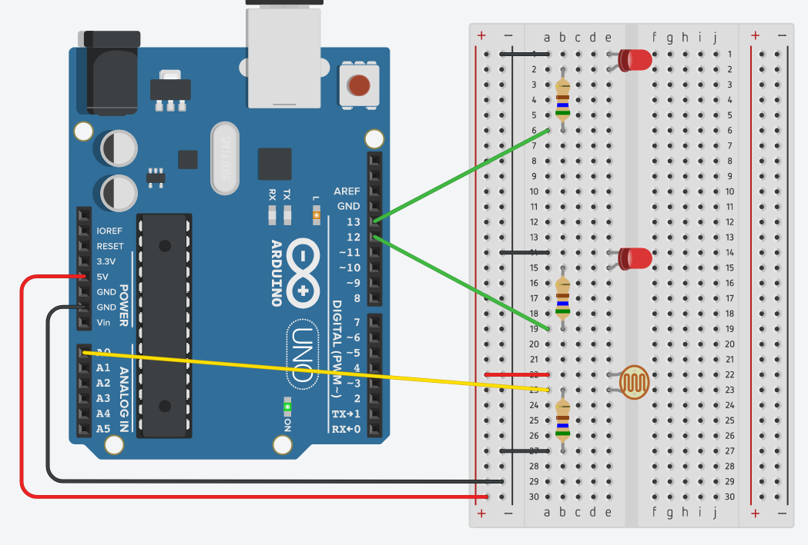

    > **Tip:** On the breadboard, the five holes in each short row are connected, so you can plug a wire or component leg into any hole in that row. The gap down the middle splits each row in two, so holes on opposite sides of the gap are not connected.

2.  Connect the Arduino to your computer using the provided USB cable.

3.  Launch the Arduino IDE.

4.  Open the [monsterbox1 sketch](../code/monsterbox1.c){:target="_blank"} and copy its code into a new Arduino sketch.

5.  In the Arduino IDE, select **Arduino Uno** as the board. In Arduino IDE 2, use the board selector. In older versions, use **Tools → Board**. Then select the port:

    - **macOS:** Open the port selector and choose the port for your Arduino. Its name may begin with `/dev/tty.usbmodem` or `/dev/cu.usbmodem`.
    - **Windows:** Open the port selector and choose the COM port for your Arduino.

6.  Click **Upload**, the right-arrow icon in the toolbar.

    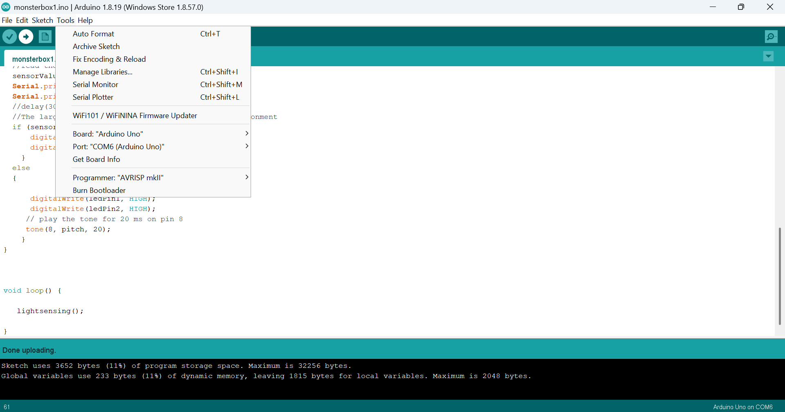

7.  Check that the LEDs are on. Cover the photoresistor with your finger, and the LEDs should turn off. When you uncover the sensor, they should turn on again.

8.  Open the **Serial Monitor**. You should see readings between 0 and 1023, which represent the light level detected by the sensor. The reading should decrease as you cover the photoresistor and may reach 0 when it is fully covered.

    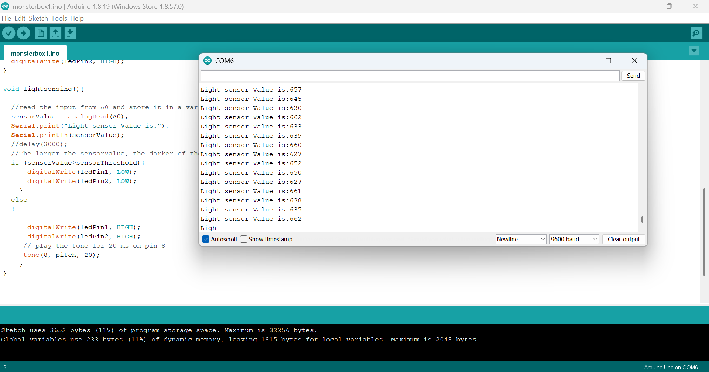

9.  Insert the LEDs into the ping-pong-ball "eyes." Using the craft knife or scissors, cut an X-shaped slit into the side of each ping-pong ball, keeping the pupil facing up. If a ball has no pupil, you can draw one with a Sharpie. Take the LEDs out of the breadboard, insert each one into a ping-pong ball, and then plug the LED legs back into the breadboard in their original positions.

    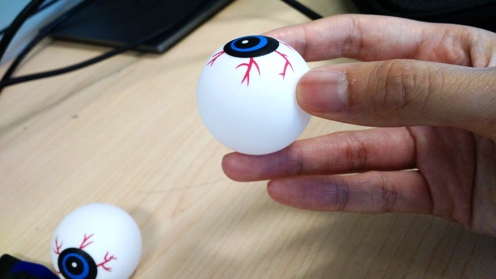

10. Take the photoresistor out of the breadboard. To detect when the box is open, the photoresistor must sit where the lid covers it when the box is closed. Cut two slits into the box under the lip of the lid, and push the photoresistor legs through the slits.

    > **Optional:** To extend the photoresistor wires so you can hide the sensor wherever it suits your decoration, use two alligator clips to connect each photoresistor leg to a jumper wire. Then plug the other end of each jumper wire into the breadboard where the photoresistor legs used to be.

    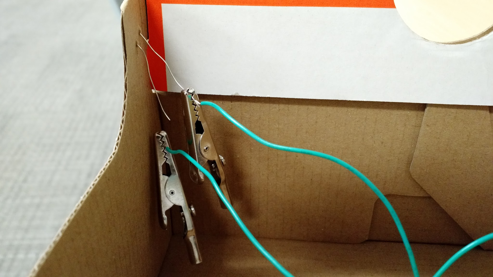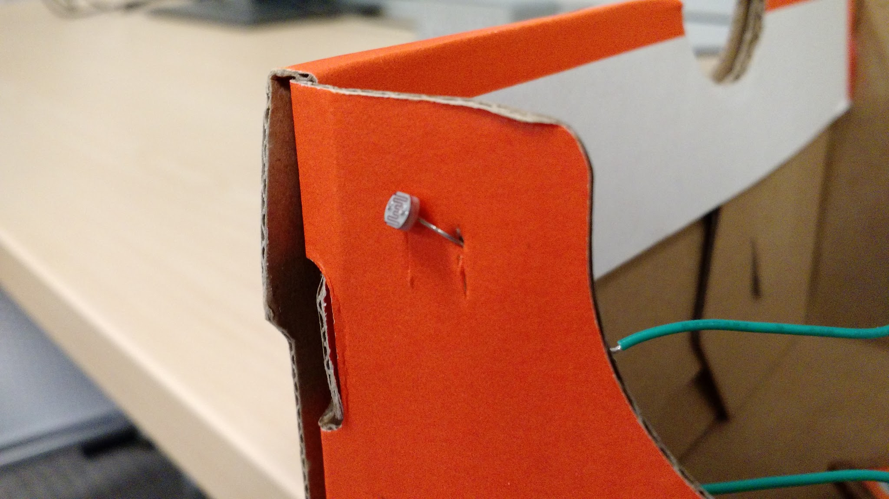

11. Test your Box Monster by opening and closing the lid.

**You did it🎉 Congratulations!**

### Examples from Previous Workshops

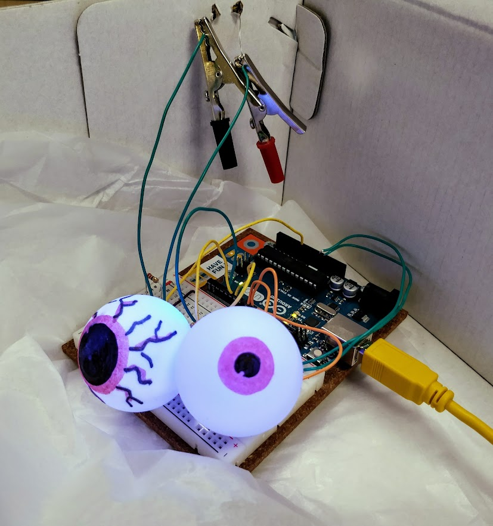

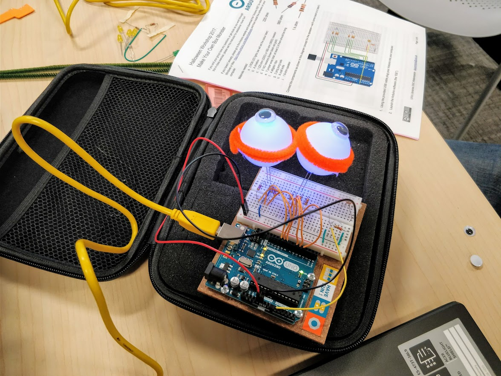

*Box Monsters made by participants at a previous workshop.*

## Add a Spooky Sound and Blinking, Colour-Changing Eyes

**👻Now make your Box Monster even more fun!**

1.  Connect the YX5300 MP3 player as shown in the diagram below. Then connect the speaker's red wire to Arduino pin 11 and its black wire to GND (Ground).

    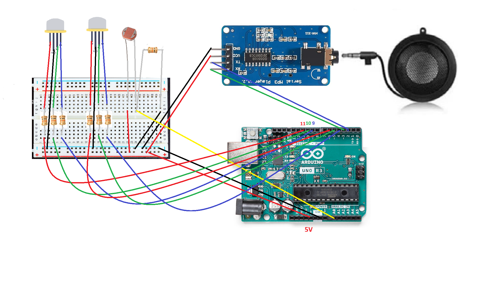

    > **Note:** The diagram uses a Hamburger mini speaker, but you can use other speakers.

    > **Optional:** Want to change colours or flash the LEDs to make the monster's eyes scarier? Replace the two regular LEDs with two RGB LEDs, connected as shown in the diagram above.

    > **Challenge:** Want to learn more about RGB LEDs and test them? Set up the circuit following the instructions above, then try the [colour-cycling example code](../code/monsterbox_rgb.c){:target="_blank"}. Edit the values passed to `setColor()`. For example, `(0, 0, 255)` produces blue in RGB colour notation. Choose an RGB colour and replace the three numbers in `setColor()` with its red, green, and blue values.

2.  Choose a sound file for your monster. Before including a sound in a public project, confirm that you have permission to use it. You can find sounds at [Free Sound Effects](https://www.freesoundeffects.com/){:target="_blank"}.

3.  If your sound file is not in .mp3 or .wav format, convert it to one of these formats. To convert a file to .wav, you can use [online-convert.com](https://audio.online-convert.com/convert-to-wav){:target="_blank"}. Name each audio file with a three-digit number, followed by three characters and the file extension, such as `001tet.wav` or `002ply.mp3`.

4.  Take the SD card out of the YX5300 board. If the SD card is new, format it first using the FAT file system. Then save your sound files to the card.

5.  Open the [sound-enabled sketch](../code/monsterbox_rgb_speaker.c){:target="_blank"} and copy its code into the Arduino IDE, replacing the previous code. Then upload the updated sketch to the Arduino.

6.  Decorate your monster and the box as you like. Have fun!

> **Note:** You may keep the box. You can also borrow the Arduino, breadboard, and other components for one week from the Music and Media desk on the first floor. Ask the DSC staff for current borrowing details.

---

## More Halloween Decoration Ideas

The following projects use the same basic Arduino circuit and components as the Box Monster above. You do not need to rebuild the circuit from scratch: start with your working Box Monster setup, adapt the decoration, and, if you like, make small changes to the sketch. Ask the instructor for help if you are unsure how to adjust the circuit or code.

> **Note:** These projects are decoration variations, not separate, pre-tested circuit designs. They reuse the Box Monster electronics, but you may need to reposition the photoresistor or adjust the sketch to get the effect you want. Test your design with the instructor before decorating over or enclosing the circuit.

### Project A: Peek-a-Boo Monster Box

Turn your Box Monster into a surprise decoration! When the box is closed, the lid covers the photoresistor. When someone opens the box, the sensor detects the light and the monster's eyes respond.

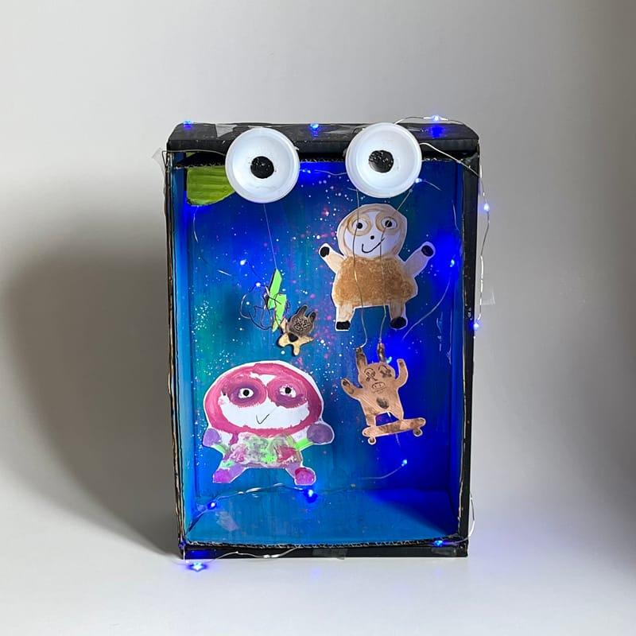

*Images generated by ChatGPT.*

#### What You Need

- The working Box Monster Arduino circuit described above, including the LEDs and photoresistor
- A small box with a lid
- Ping-pong balls or eyeball balls for the eyes
- Craft supplies such as stickers, glitter foam shapes, chenille stems, pom-poms, letter beads, or other decorations available at the workshop

#### Make It Your Own

1.  Decorate the outside of the box to create a monster, a haunted creature, or any character you like.
2.  Use the ping-pong balls or eyeball balls as the eyes.
3.  Position the photoresistor so that the closed lid covers it and opening the lid exposes it to light. The detailed wiring steps are in the main Box Monster instructions above.
4.  Upload and test the Box Monster sketch. Open and close the lid to see how the eyes respond.
5.  **Optional:** If time permits, customize the eye colour or blinking behaviour by changing the sketch with help from the instructor.

> **Try this:** Can you make the monster look sleepy when the box is closed and surprised when it opens? Change its face and decorations to match the effect.

### Project B: Haunted Eyeball or Spiderweb Display

Use the same LED and photoresistor circuit to create a glowing Halloween decoration without a box. Make a cluster of glowing eyeballs, a spiderweb scene, or a spooky mini display.

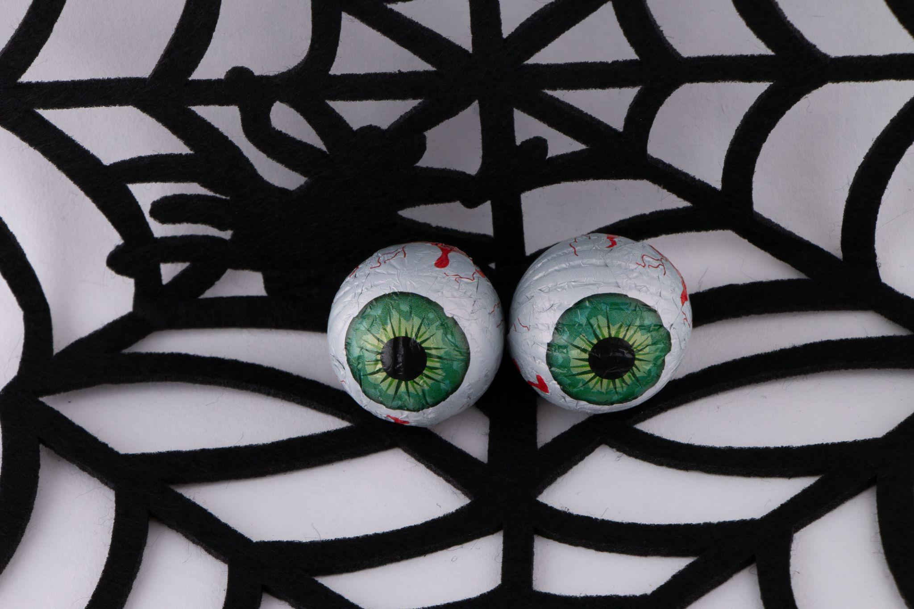

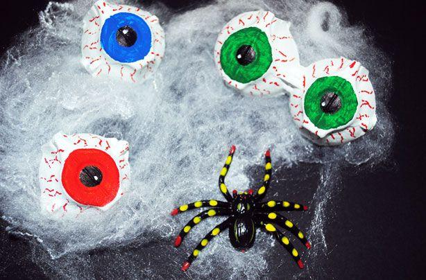

*Images generated by ChatGPT.*

#### What You Need

- The working Box Monster Arduino circuit described above, including the LEDs and photoresistor
- Ping-pong balls or eyeball balls for the eyes, or other lightweight decorations that LEDs can light up
- A small cardboard base or other stable display surface
- Craft supplies such as spiderweb material, rubber bats, twine, chenille stems, stickers, glitter foam shapes, pom-poms, or letter beads

#### Make It Your Own

1.  Create a spiderweb or spooky scene on your display base, and arrange the eyeballs wherever you want them to appear.
2.  Place the LEDs inside or behind the eyeballs.
3.  Keep the photoresistor exposed to the room light so it can detect changes in brightness. The main Box Monster sketch uses this sensor to control the LEDs; the instructor can help you adapt the sensor placement and behaviour for your display.
4.  Test the LEDs, then decorate the display around the circuit. Make sure craft materials do not pull on the wires or cause short circuits.
5.  **Challenge:** Try changing the blink timing or eye colours in the sketch. The main instructions above explain how to upload the sketch and edit the colour settings.

> **Try this:** Make the eyes glow in a dark corner, or design a spiderweb display with several eyes watching visitors. The exact effect will depend on the sensor placement and any changes you make to the sketch.
